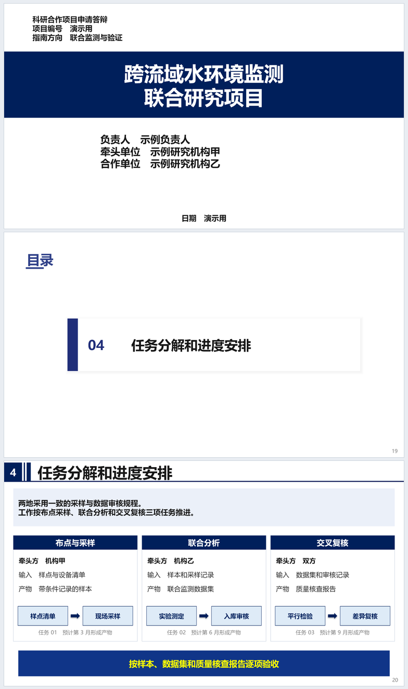

# 项目申请版式

来源《2024中埃可持续城市水系统联合实验室申请答辩PPT-1118.pdf》，共 38 页。坐标为 960 × 540 pt 画布参考值。图片为重绘的版式示例，使用演示数据。

## 叙事和视觉参数

默认顺序为立项依据与合作、研究内容、目标与技术路线、任务分解与进度、团队与工作基础、成果与风险。指标、预算和知识产权按申请要求放入对应章节。串起「需求、可执行的任务、承担方、验收证据」。用同一套任务名称对应技术路线、职责、排期和验收指标。

| 元素 | 复用规则 |
| --- | --- |
| 色彩 | `#001F5B` 用于编号块、分隔线和白字栏头，`#F2F2F2`、`#EBF0F9` 用于说明底板，`#DEEBF7` 用于图注。白底重点词可用 `#C00000`，深色结论条上可用 `#FFFF00` 标出关键交付物或数字。原稿个别页采用 `#FF0000`，可用深红统一对比。路线和排期可按任务使用不同颜色，并同时标注任务名。 |
| 编号页眉 | 页首约 y=4–50（部分原页整体下移约 15 pt）。左端深蓝编号块宽约 43–52 pt，右接两根窄竖线，再接 x≈80 的黑色主标题。编号白色 18–24 pt 加粗，标题约 36 pt 加粗。页眉下沿细蓝横线贯穿画布，副题可用 22–24 pt。 |
| 内容组件 | 页眉下可放深蓝局部栏头，白字 18–20 pt。正文 16–20 pt，表格、图注约 12–16 pt。关键进度、分工、考核内容采用规整面板或有清楚行列标题的表格。 |
| 页尾 | 证据页可用留两侧边距的深蓝结论框，常见 x≈34–926、y≈455–517，提炼该页证据能够支持的履约或交付判断，关键短语可用黄字。没有结论框时，右下角可保留约 12 pt 灰色页码。 |

## 页面选择

| 页面 | 结构 | 原稿定位 |
| --- | --- | --- |
| 申请封面与致谢 | 上方左放项目类别、编号和指南方向，约 18 pt 加粗，右上放授权机构标志。全宽深蓝标题横带约 y=115–274，白色主标题 48 pt，居中且可双行。横带下为负责人和申报单位信息，约 24 pt 加粗，日期在页底。致谢复用同构版式，横带内放项目名及致谢。 | 1、38 |
| 目录与章节过渡 | 左上目录约 32 pt，短蓝下划线约 43 pt。整页六张卡 x≈156、y≈92、宽 710、高 64，卡间仅约 5 pt。过渡页一张 x≈152、y≈207、宽 703、高 126 的白卡。两者均为蓝色左竖条、浅阴影、约 32 pt 的两位编号与黑色章名。 | 2–3、9、15、19、22、33 |
| 立项和工作基础 | 顶部先给背景或事实条目，下方用两到三列同高的照片、地图、报告、论文或成果图，每组有深蓝栏头或浅蓝图注。合作证明材料保留足以辨识的出处与日期，说明各项证据能支撑的能力。 | 4–8、23–31 |
| 研究内容与技术路线 | 内容概览用「任务模块、关键问题」双栏或编号对应块。路线页把问题或三类任务放左、中部放处理链与验证环节、右侧放能力或成果。颜色随任务贯穿路线和排期，节点与箭头表达先后或依赖。 | 10–17 |
| 任务安排与进度 | 分解和分工并排，区分牵头方、配合方与共同产物。进度页左置甘特表，右列年度里程碑或关键节点。时间单位、任务名和交付件在图表两边一致。 | 20–21、32 |
| 成果、风险与预算 | 考核表包含预期成果、量化指标和考核方式。风险表对应风险、发生可能性和措施。预算用两列表格对齐科目和金额，旁置总额、资金来源与主要分项，表头明确币种和金额单位。 | 18、34–37 |
