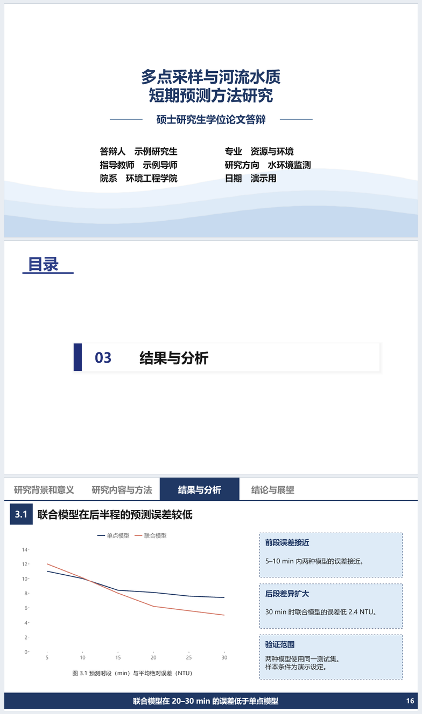

# 论文答辩版式

来源《硕士论文答辩PPT-WWJ.pdf》，共 41 页。坐标为 960 × 540 pt 画布参考值。图片为重绘的版式示例，使用演示数据。

## 叙事和视觉参数

默认顺序为研究背景与意义、研究内容与方法、结果与分析、结论与展望。把已有研究的不足连到科学问题，把方法连到可检验的证据。结果页按「条件或对照、证据、解释、可适用范围」组织。用结论页汇总发现，用展望页把具体局限与验证工作一一对应。

| 元素 | 复用规则 |
| --- | --- |
| 色彩 | `#203864` 用于当前导航项、章节编号底和结论条。`#7F7F7F` 用于非当前章节。`#DEEBF7`、`#B4C7E7` 用于表头、信息和方法面板，细边框可用 `#4472C4`。个别关键数值用 `#C00000`。多组数据按图表语义设色。 |
| 顶部章节导航 | y≈0–54。四个导航项从左到右排到 x≈680，长标签可占约 185 pt，短标签约 150–176 pt。当前项深蓝底白字，其余白底灰字。导航文字 20 pt 加粗。右侧留给已确认的校院标志及字标。下沿为细蓝线。 |
| 内容标题 | 标题行 y≈60–109。x≈13 放宽 13 pt 的竖条。结果页可换成宽约 53 pt 的深蓝编号块，20 pt 白字。黑色标题 24 pt 加粗，起点约 x=39（竖条）或 x=77（编号块）。 |
| 正文 | 图表区通常始于 y≈110，正文 14–18 pt，小标题 16–18 pt 加粗。图注、表内字号以 12–14 pt 为起点。正文字号取自常用范围，原稿少量嵌入图标签更小。 |
| 页底 | 有明确判断的结果页用全宽 `#203864` 结论条，高约 32–40 pt，通常从 y≈496–504 开始，右端留页码位。白色结论短句 16–18 pt 加粗。可在结论左边配一个白色灯泡或用清晰的对齐留白。纯方法页、总路线页和结论汇总可按内容省去结论条，页码置右下。 |

## 页面选择

| 页面 | 结构 | 原稿定位 |
| --- | --- | --- |
| 学术封面与致谢 | 封面上方居中放授权校院标志，蓝色主标题 36 pt，允许双行，下方约 y=320–450 以两列排列答辩人、导师、院系、专业和日期等已确认信息。底部可用与研究领域有关的淡蓝剪影和波形，并压低背景对比。致谢复用底图和元信息，中央用约 44 pt 深色致谢。需要校级仪式页时可在学术封面前增加一张红底页，参考 `#D6382F` 背景与 `#FFFCAA` 标题。 | 1–2、41 |
| 目录与章节过渡 | 目录 36 pt，标题左上约 x=56，宽约 119 pt 的蓝色下划线。整页四张卡 x≈174、y≈92、宽 710、高 64、行距约 114 pt。过渡页只保留一张 x≈160、y≈238 的 710 × 64 pt 卡。卡条约 19 pt 宽，编号和章名用约 32 pt 加粗字。 | 3–4、9、15、38 |
| 痛点与研究问题 | 背景页左放趋势图和短痛点，右放现场照片及图注。研究现状页用「已有研究、主要不足、切入点」三栏接一张对照表或示意图，末端给出科学问题与意义。 | 5–8 |
| 路线与方法 | 路线图按研究模块分列，上方连到总问题，下方汇入共同输出。实验设计用窄栏列方法要点，宽栏用流程图和校准结果交代输入、操作和输出。测试矩阵用统一规格的面板，每栏说明测什么、怎么测。 | 10–14 |
| 对照、机理及模型结果 | 关键对照用近 1:1 双栏。多联图加解读卡用约 60:40，图表在左、三条解释或运行建议在右。机理对照可用「图表、机制示意、图表」三栏。照片阵列保持尺度和条件一致。模型页放能回答该问题的散点、误差、消融或稳健性证据，并保留验证范围。 | 16–26、29–37 |
| 结论与展望 | 结论用两三组深蓝标题条加可追溯发现。展望表按研究主题列出不足与后续验证方式。两类列表都沿用当前章节导航。 | 39–40 |
